<!-- ───────────────────────────────────────────────────────────────
     Yousef Osama · profile README
     Theme: "compiling a full-stack developer"
     Palette: React #61DAFB · Python #FFD43B · Django #44B78B
     All banners in ./assets are hand-made animated SVGs.
     ─────────────────────────────────────────────────────────────── -->

  

  
  
  
  

 

  

## `01` &nbsp;·&nbsp; Who I am

I'm **Yousef** — a developer on a clear mission: become a **full-stack engineer** building with **React** on the front and **Python / Django** on the back.

I'm being honest about where I stand: the **frontend is unlocked** — I can design and ship clean, responsive interfaces today. The **backend is the next level** I'm grinding through right now. Every repo here is a checkpoint on that journey, and I'm learning in public.

> *"I don't wait until I'm ready. I build until I am."*

 

## `02` &nbsp;·&nbsp; The roadmap

  

 

## `03` &nbsp;·&nbsp; Toolbox

<table>
  <tr>
    <td align="center" width="33%"><b>⚡ Shipping with</b> use these confidently today</td>
    <td align="center" width="33%"><b>🔥 Leveling up</b> learning right now</td>
    <td align="center" width="33%"><b>🔭 On the horizon</b> next on the list</td>
  </tr>
  <tr>
    <td align="center"></td>
    <td align="center"></td>
    <td align="center"></td>
  </tr>
</table>

 

## `04` &nbsp;·&nbsp; What I can build — today vs. tomorrow

| &nbsp; | Right now ✅ | Coming soon ⏳ |
| :-- | :-- | :-- |
| **Interfaces** | Responsive landing pages & layouts | Component-driven React apps |
| **Interactivity** | DOM manipulation, forms, small JS apps | State management, hooks, routing |
| **Backend** | — | Django models, views & admin |
| **APIs** | Consuming public APIs with `fetch` | Building REST APIs with Django REST Framework |
| **Full-Stack** | — | React frontend ⇄ Django API, end to end |

 

## `05` &nbsp;·&nbsp; GitHub pulse

  
  

  

 

## `06` &nbsp;·&nbsp; Let's connect

I'm always happy to talk code, swap feedback on projects, or team up on something small while I learn.

  
  <!-- Add your links here, e.g.:
  
  
  -->

 

  

